# job-poster-write · 全文海报招聘公告转排版技能

专门针对**全文海报、长图、多卡片类招聘公告**设计的端到端生产流水线。后续所有全文海报性质的招聘公告统一由本技能承接处理。

> **核心设计哲学**：
> 1. **极简 Token 消耗**：全流程仅在「AI 读图切片 → 填充 `facts.json`」消耗大模型 Token，其余抓取、查重、机检、组版、裁图、推送与对账 100% 自动化零 Token。
> 2. **事实溯源防编造**：所有提炼数据必须附带切片原图证据；中介号强制回源；截止日期未写一律记「公告未披露」，严禁脑补推演。
> 3. **无缝视觉拼合**：单张超长图按 2000px 纵向切段 + 60px 重叠防断字；HTML 段间使用 `-1px` 负边距抵消亚像素缝隙，消除微信客户端中的白线接缝。

---

## 流程概览（标准七步法）

```dot
digraph pipeline {
    rankdir=LR;
    node [shape=box, style="rounded,filled", fillcolor="#f9f9f9"];
    fetch [label="① fetch\n抓图切段/形态判断\n(零Token)", fillcolor="#e1f5fe"];
    preflight [label="② preflight\n数据库查重\n(零Token)", fillcolor="#e1f5fe"];
    facts [label="③ AI 读图\n填 facts.json\n(唯一 Token 步)", fillcolor="#fff9c4"];
    check [label="④ facts-check\n格式/敏感词机检\n(零Token)", fillcolor="#e1f5fe"];
    gen [label="⑤ gen + cover\n组版+封面裁切\n(零Token)", fillcolor="#e1f5fe"];
    push [label="⑥ push\n推送微信草稿箱\n(零Token)", fillcolor="#e1f5fe"];
    post [label="⑦ postprocess\n交付小结+写日志\n(零Token)", fillcolor="#e1f5fe"];

    fetch -> preflight -> facts -> check -> gen -> push -> post;
}
```



---

## 命令清单与执行步骤

脚本主入口：`scripts/job_poster_pipeline.py`（兼容 `scripts/wx_article_pipeline.py`）

### ① 抓取与形态探测（`fetch`）
调用底层 `mp-save` 引擎抓取微信文章、提取高清原图（`/0?` 通道），并对高分辨率长图自动按 2000px 切段（带 60px 重叠防断字）：
```bash
python3 scripts/job_poster_pipeline.py fetch "<微信推文URL>" --dir /tmp/wxwork_<单位名>
```
产出物：
- `meta.json`：原文元数据、发布者、形态判读（`long` / `multi` / `text`）
- `images/`：高清原图
- `images/segs/`：2000px 长图切片（供多模态 AI 读图提取）

### ② 查重校验（`preflight`）
校验单位是否已写过或已发布；支持传入可选 SQLite 数据库（`--db` 参数或 `PIPELINE_DB` 环境变量）查重，未指定时跳过本地库查重：
```bash
python3 scripts/job_poster_pipeline.py preflight "<单位全称或简称>" [--db <path/to.db>]
```

### ③ AI 读图并填充 `facts.json`
AI 读取切片图片（`images/segs/*.png`），提取硬核事实并写入工作目录下的 `facts.json`（字段模板详见下文）。

### ④ 自动化机检断言（`facts-check`）
零 Token 校验必填字段、字数长度限制、极限词溯源断言及回源纪律：
```bash
python3 scripts/job_poster_pipeline.py facts-check /tmp/wxwork_<单位名>/facts.json
```
- **标题**：`title` 长度必须 ≤ 64 字符
- **摘要**：`digest` 长度必须 ≤ 120 字符
- **词汇核验**：出现“正式编制/直签/第一/最高/落户”等词汇必须在 `raw_evidence` 中附带证据
- **回源纪律**：非官方系账号（聚合号/中介号）推文严禁作为源，必须指回官网公告

### ⑤ 组版与封面制作（`gen` + `cover`）
```bash
# 生成排版 HTML（自动应用品牌色、三宫格与负边距切片拼合）
python3 scripts/job_poster_pipeline.py gen /tmp/wxwork_<单位名>/facts.json

# 裁剪长图顶部（默认 0~460px）并缩放到 900x383 标准微信大图封面
# 推荐用法：直接传入 facts.json，自动从 facts 提取源图、slug 与落点目录，杜绝路径分裂
python3 scripts/job_poster_pipeline.py cover /tmp/wxwork_<单位名>/facts.json

# 也支持指定单张图片与自定义裁剪范围：
# python3 scripts/job_poster_pipeline.py cover /tmp/wxwork_<单位名>/images/img_01.png --slug "<slug>" [--line-dir "待发布目录"] [--top 0 --bottom 460]
```

### ⑥ 推送到公众号草稿箱（`push`）
内置自动前置触发 `facts-check` 机检，调用 `mp-publish` 推送至微信公众号草稿箱：
```bash
python3 scripts/job_poster_pipeline.py push /tmp/wxwork_<单位名>/facts.json [--profile mashang]
```

### ⑦ 交付小结与日志（`postprocess`）
输出最终交付卡片与概要信息，在 facts 目录下持久化 `pipeline_summary.json`，并支持可选追加到指定日志文件：
```bash
python3 scripts/job_poster_pipeline.py postprocess /tmp/wxwork_<单位名>/facts.json [--log <path/to.log>]
```

---

## `facts.json` 规范字典

运行 `python3 scripts/wx_article_pipeline.py --facts-help` 可查看完整定义：

```json
{
  "source_url": "https://...",
  "source_kind": "official_account",
  "publisher": "发布者公众号名称",
  "title_official": "官方原标题",
  "publish_date": "2026-11-04",
  "company": "单位简称（标题用）",
  "company_full": "单位全称",
  "line_dir": "事业单位/待发布",
  "brand": "#1890ff",
  "brand_dark": "#096dd9",
  "date_tag": "2026-11-04",
  "slug": "单位简称-校招",
  "deadline": "2026-11-30",
  "audience": "2027届国内外应届毕业生",
  "positions": "研发工程师、管培生等若干岗",
  "locations": "南京、北京、上海",
  "apply": "网申链接或指定投递方式",
  "title": "推文标题（≤64字）",
  "digest": "推文摘要（≤120字）",
  "highlight_items": [
    "提炼要点1",
    "提炼要点2",
    "提炼要点3"
  ],
  "grid": [
    {"label": "截止时间", "value": "11月30日"},
    {"label": "招聘对象", "value": "2027应届"},
    {"label": "工作地点", "value": "南京等地"}
  ],
  "body_imgs": [],
  "stack_b64_imgs": [
    "/tmp/wxwork_xx/images/segs/seg_01_01.png",
    "/tmp/wxwork_xx/images/segs/seg_01_02.png"
  ],
  "raw_evidence": "长图原文关键句摘抄...",
  "source_note": "信息来源：官方微信公众号公告"
}
```

---

## 铁律与避坑指南

1. **接缝白线问题**：
   长图切片在移动端拼接时，由于屏幕缩放亚像素计算容易出现细微白线。脚本已固化：同一 section 容纳所有切片，段间应用 `-1px` 负边距，且必须清除行高（`line-height:0; font-size:0;`），**严禁加圆角 `border-radius`**（圆角会在接缝处露底）。
2. **防切断文字**：
   切片步长 2000px，必须附加 60px 垂直重叠（overlap），确保没有文字刚好被整行切断而丢失信息。
3. **回源纪律**：
   中介转载号（如求职汇等）严禁作为 source_url；必须核查官方公众号、官网或官方网申平台，溯源真实链接。
4. **截止时间严禁推演**：
   若长图中未明确写明截止日期，必须填写 `公告未披露` 或 `招满即止`，绝不能主观臆测。
